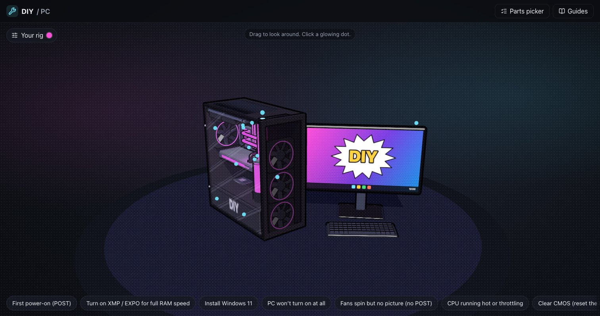

# DIY

Fix it yourself. Interactive, comic-styled 3D workshops: click the part that's giving you trouble, follow the steps, and open how-to videos on YouTube.

| Workshop | Status |
|---|---|
| PC | Live in this repo (`/pc/`) |
| Garage | Lives at [diy-garage](https://github.com/Sea-Chels/diy-garage) for now, moving here |
| Home | Planned |
| Garden | Planned |

Purely client-side: Vite + TypeScript + Three.js + Lucide, no backend, no database.


## PC workshop

A glass-sided PC on a desk beside a monitor. Click a glowing dot and the camera flies in, the side panel swings open, the cooler lifts off the CPU, the shroud folds down over the PSU and drives. Press the power button to watch it POST, enter the BIOS, run an OS installer and land on the desktop.


| BIOS & OS setup | Custom loop, full tower |
|---|---|
|  |  |

- **Your rig:** Mini-ITX, mid or full tower; air, AIO or custom loop; no, dual or triple-fan GPU; RGB off, solid or rainbow; case colour.
- **Guides:** troubleshooting (no power, no POST, overheating, crashes, missing drives), replacing parts (RAM, GPU, M.2, PSU, thermal paste, CPU, cooler, fans, motherboard, CMOS battery) and setup (first boot, BIOS, XMP/EXPO, BIOS updates, bootable USB, Windows and Linux installs, drivers).
- **Parts picker:** pick a CPU, board, RAM, GPU, cooler, case, PSU and drives from a curated list and get compatibility checks (socket, memory type, form factor, GPU length, cooler height, radiator size, PSU form factor and wattage, M.2 slots, missing graphics output). Every part links to PCPartPicker for prices; "Show this build in 3D" updates the model.


## Run

```sh
pnpm install
pnpm dev        # http://localhost:5173, the PC workshop is at /pc/
pnpm build      # outputs dist/
```

## Data sources

| What | Where | Cost |
|---|---|---|
| Guides, steps, tools, cautions | `src/pc/data/guides.ts`, hand-written | Free |
| Parts list and specs for the picker | `src/pc/data/catalog.ts`, hand-curated and rounded | Free |
| Prices and full specs | Links to PCPartPicker search, opened in a new tab | Free |
| Videos | A YouTube search for the job (plus your picked part's name), opened in a new tab | Free |

## Project layout

```
index.html               hub page
pc/index.html            PC workshop page
src/
  shared/                toon shading + ink outlines, tweens, DOM helpers, icons, modal, base styles
  hub/                   hub script and styles
  pc/
    data/parts.ts        clickable parts (PartId) and which lids open for each
    data/guides.ts       the guide catalog; add guides here
    data/catalog.ts      parts for the picker
    data/compat.ts       compatibility checks and power estimate
    data/setup.ts        case size, cooling, GPU, RGB options
    scene/rig.ts         the stylized PC, monitor and keyboard
    scene/screen.ts      what the monitor shows (POST, BIOS, installer, desktop)
    scene/scene.ts       renderer, lights, picking, camera fly-to
    ui/*                 side panel, guide index, rig menu, parts picker
```

Each workshop is its own Vite page (see `vite.config.ts`), so adding Home or Garden means a new folder with an `index.html` plus its `src/<name>/` code, reusing `src/shared/`.

### Adding a guide

Add an entry to `GUIDES` in `src/pc/data/guides.ts`. List the parts it belongs to in `parts`, add search words to `aliases`, set `cooling` if it only applies to AIOs or custom loops, and set `ctx` to a picker category so the video search names the user's part. Set `featured: true` to put it in the bar along the bottom.

### Adding a part to the picker

Add an entry to `CATALOG` in `src/pc/data/catalog.ts` with the fields its category needs. `checkBuild` in `src/pc/data/compat.ts` picks it up automatically.

## Deploy to GitHub Pages

1. In the repo, go to Settings, then Pages, and set Source to "GitHub Actions".
2. Run the "Deploy to GitHub Pages" workflow from the Actions tab. To deploy on every push instead, add a `push` trigger for `main` in `.github/workflows/deploy.yml`.

The workflow builds with the right base path and publishes `dist/`.
