# DIY

Fix it yourself. Interactive, comic-styled 3D workshops: click the part that's giving you trouble, follow the steps, and open how-to videos on YouTube.

**Try it: [sea-chels.github.io/diy-app][site]**

| Workshop | Live site |
|---|---|
| PC | [/pc/][site-pc] |
| Garage | [/garage/][site-garage] |
| Home | [/home/][site-home] |
| Garden | [/garden/][site-garden] |

<!-- The deploy publishes to /<repo name>/ on the owner's Pages domain; update these if the repo moves. -->
[site]: https://sea-chels.github.io/diy-app/
[site-pc]: https://sea-chels.github.io/diy-app/pc/
[site-garage]: https://sea-chels.github.io/diy-app/garage/
[site-home]: https://sea-chels.github.io/diy-app/home/
[site-garden]: https://sea-chels.github.io/diy-app/garden/

Purely client-side: Vite + TypeScript + Three.js + Lucide, no backend, no database.

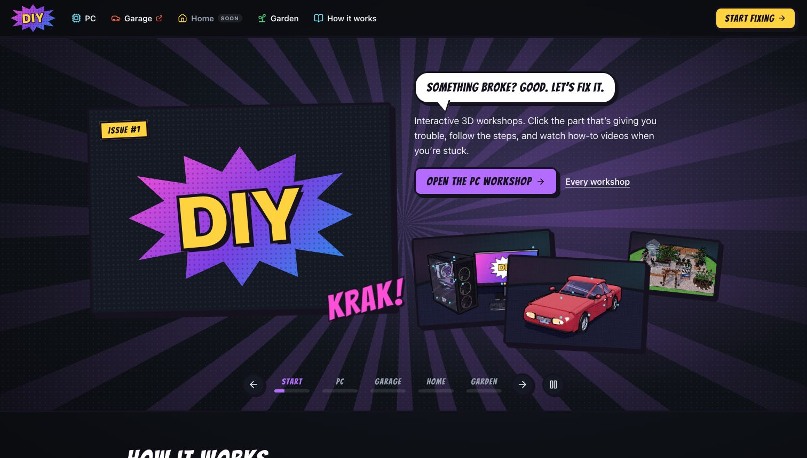

## PC workshop

A glass-sided PC on a desk beside a monitor. Click a glowing dot and the camera flies in, the side panel swings open, the cooler lifts off the CPU, the shroud folds down over the PSU and drives. Press the power button to watch it POST, enter the BIOS, run an OS installer and land on the desktop.

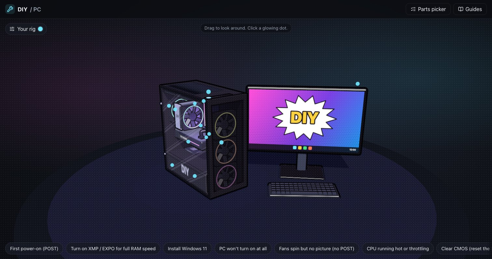

| BIOS & OS setup | Custom loop, full tower |
|---|---|
| 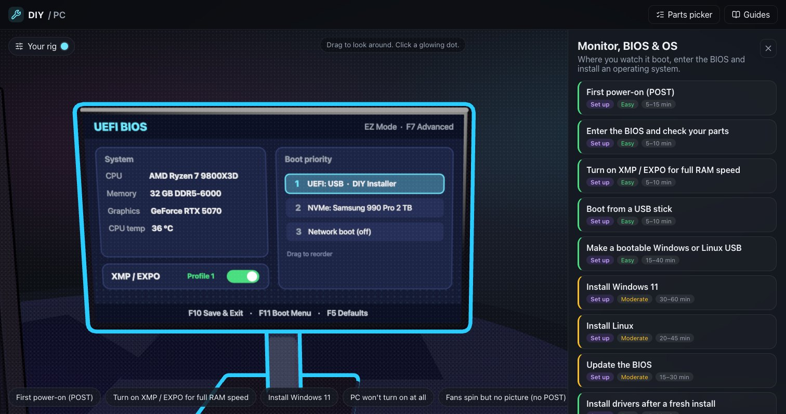 |  |

- **Your rig:** Mini-ITX, mid or full tower; air, AIO or custom loop; no, dual or triple-fan GPU; RGB off, solid or rainbow; case color.
- **Guides:** troubleshooting (no power, no POST, overheating, crashes, missing drives), replacing parts (RAM, GPU, M.2, PSU, thermal paste, CPU, cooler, fans, motherboard, CMOS battery) and setup (first boot, BIOS, XMP/EXPO, BIOS updates, bootable USB, Windows and Linux installs, drivers).
- **Parts picker:** pick a CPU, board, RAM, GPU, cooler, case, PSU and drives from a curated list and get compatibility checks (socket, memory type, form factor, GPU length, cooler height, radiator size, PSU form factor and wattage, M.2 slots, missing graphics output). Every part links to PCPartPicker for prices; "Show this build in 3D" updates the model.


## Garage workshop

A comic sedan or SUV, a motorcycle and a bike parked together. The Car / Motorcycle / Bike switch at the top flies the camera to each one. Pick your year, make and model (models come from NHTSA's vPIC list) and the car videos search for your exact car. Click a glowing dot and the camera flies in: the hood lifts on the engine bay, the trunk or liftgate swings up on the spare, the driver's door opens on the cabin, the wipers sweep, and the motorcycle seat lifts on its battery.

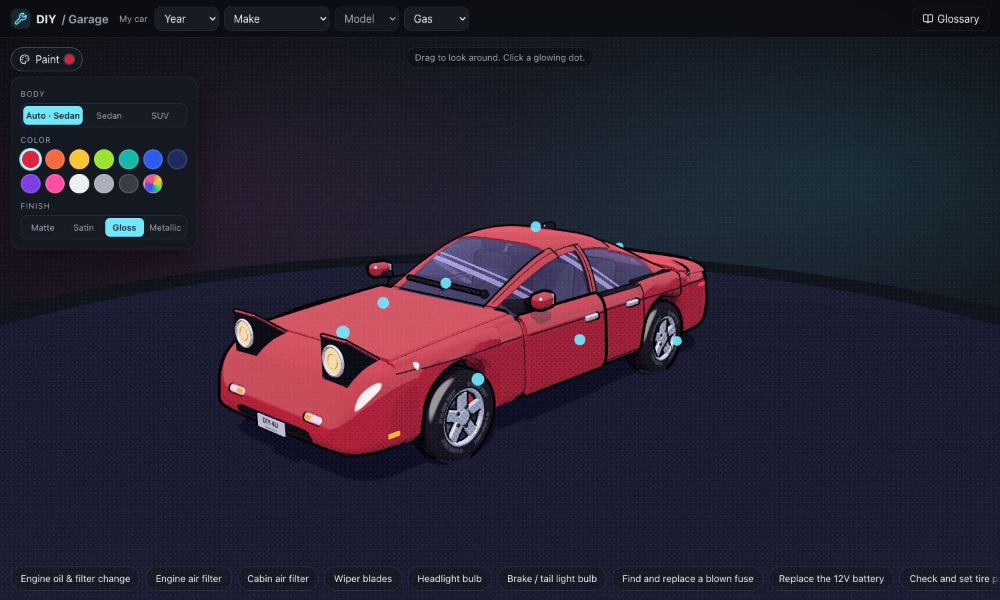

| A guide | Every fix |
|---|---|
| 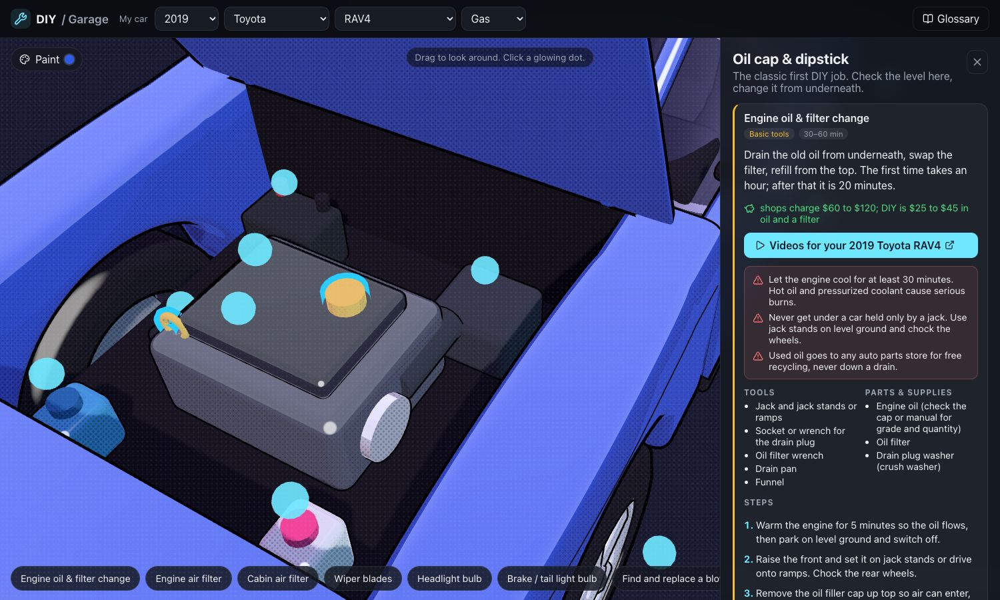 | 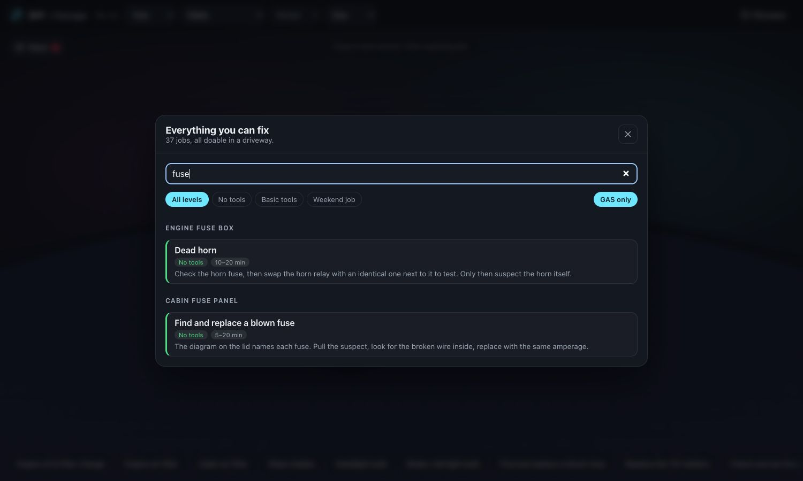 |

- **Your car:** year, make, model and powertrain (gas, diesel, hybrid or electric, guessed from the model). Jobs that don't apply, like oil changes on an EV, drop out.
- **Paint:** body (auto from the model, sedan or SUV), color and finish (matte, satin, gloss or metallic).
- **Guides:** 54 jobs. 37 for the car: oil and filters, wipers and fluids, bulbs and cloudy headlights, fuses, the 12V battery and jump starts, spark plugs, belts and sensors, tires, flats and brake pads, key fobs, check-engine codes, struts, mirrors and touch-up paint. 9 for the motorcycle: tires, chain lube and slack, oil level and changes, the battery, brakes, bulbs and clutch play. 8 for the bike: pumping up, flats, chain cleaning and wear, brake cables and pads, gear indexing and saddle height. Each one says what a shop would charge and lists jack, hot-engine and brake-test cautions where they matter.

## Garden workshop

A lush comic garden: raised beds, a Three Sisters patch, a hoop tunnel, compost bays, a hydroponic tower, a herb spiral, fruit, a pollinator patch, an arbor and a shed pantry. Click a glowing dot and the camera flies in. The raised bed's front swings away to show what's inside, the shed doors open on the pantry shelves, the compost slats come off and the row cover rolls back.


| Raised bed cutaway | Plant guide | Bed planner |
|---|---|---|
| 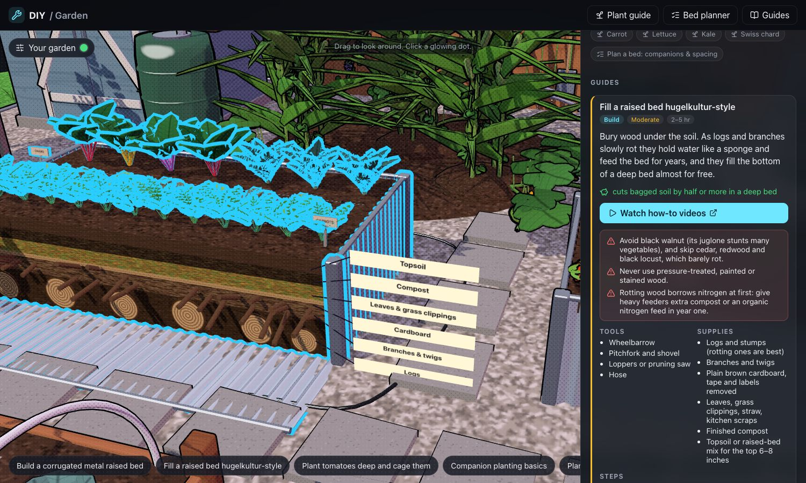 | 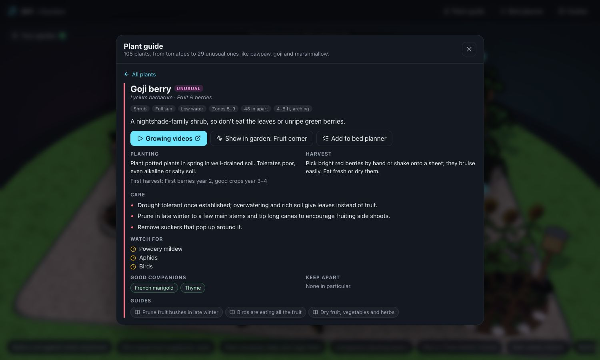 | 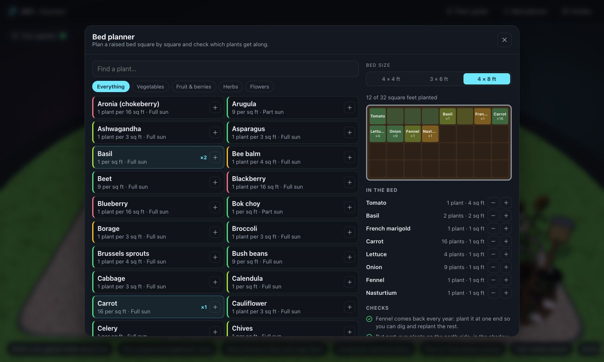 |

- **Your garden:** season (spring, summer, fall), how the cutaway bed is filled (hugelkultur, lasagna layers or a soil mix) and the hydroponic system (PVC tower, NFT rack or deep-water tote).
- **Guides:** building beds, compost bins, rain barrels, drip lines, hydroponic systems, a herb spiral, a bee hotel and an arbor; growing (companion planting, Three Sisters, seed starting, pawpaws, blueberries, pruning); troubleshooting (blight, blossom-end rot, pests, compost problems, root rot); and preserving (water-bath and pressure canning, freezing, drying, sauerkraut, root cellaring). Canning guides follow USDA/NCHFP tested methods and link to them.
- **Plant guide:** care cards for over 100 plants, from tomatoes and kale to pawpaw, goji, haskap, marshmallow root, wasabi and saffron. Each card covers sun, water, zones, spacing, planting, care, harvest, problems and companions.
- **Bed planner:** pick plants for a 4×4, 3×6 or 4×8 ft bed and see them laid out square-foot style. It flags poor neighbors and sun, water and soil-pH clashes, and suggests good companions. The plan is saved in the browser.

## Home workshop

An open cutaway room, like a dollhouse with the front and right walls removed: a kitchen along the back wall, a small bathroom behind half-height walls, a living area, and a front door and breaker panel on the left wall. It turns all the way round, so the outside is part of it too: siding, gutters and a downspout, a hose bib, a porch light and an outdoor outlet. Click a glowing dot and the camera flies in. The sink cabinet opens on the P-trap and shut-off valves, the toilet tank lid comes off, the outlet cover plates drop to show the wiring, the fan's canopy drops to show the fan-rated box, floor planks lift and a loose siding panel swings out to show the house wrap.

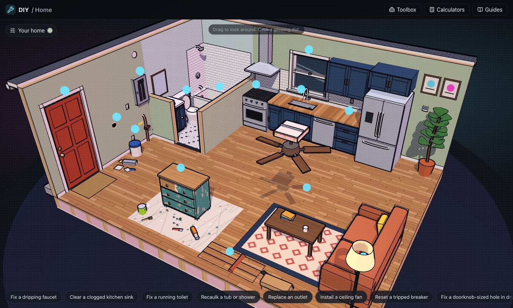

| Outside | A guide | Toolbox |
|---|---|---|
| 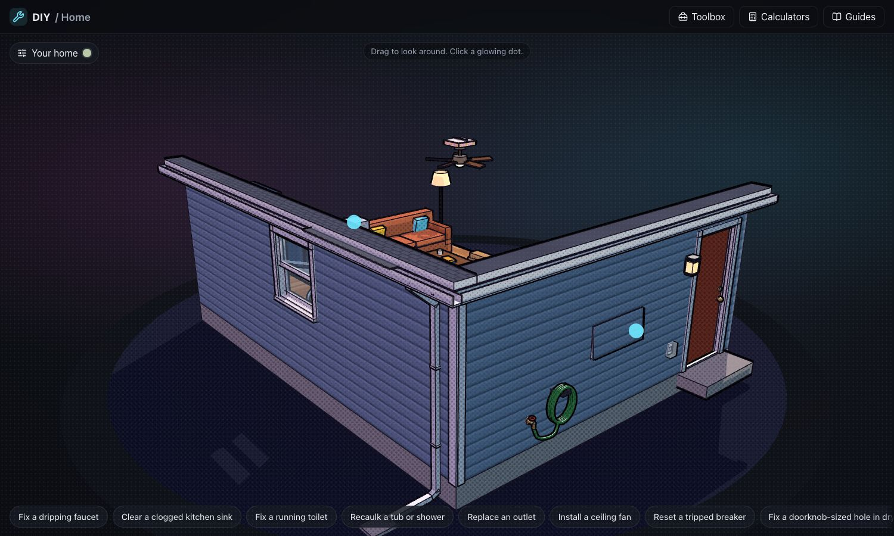 | 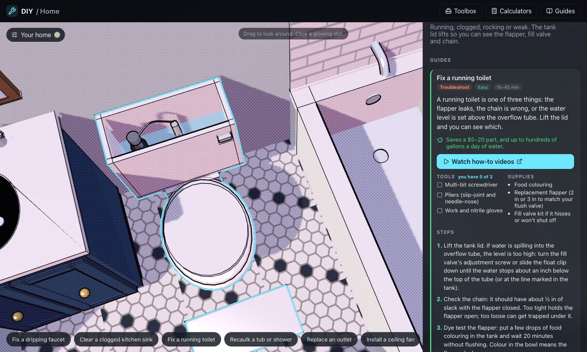 | 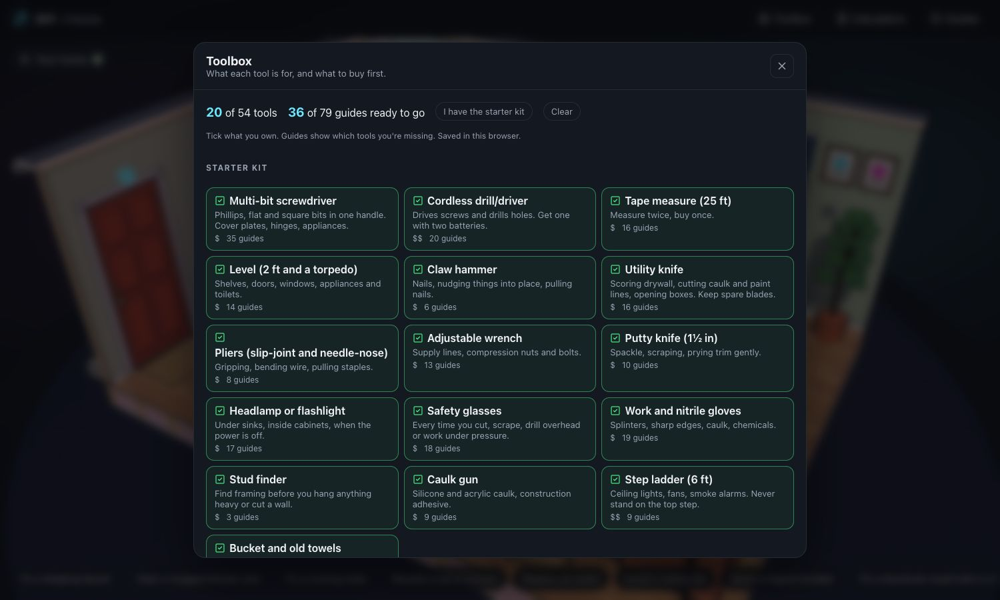 |

- **Your home:** countertop (laminate, butcher block or quartz), ceiling (fan or light fixture), floor (hardwood, vinyl plank or tile) and wall color. The guide that matches what's on the model goes to the top of its list.
- **Guides:** troubleshooting (dripping faucets, clogs, running toilets, tripped breakers, dead outlets, sticking doors), installing and replacing (faucets, disposals, countertops, dishwashers, outlets, GFCIs, switches, light fixtures, ceiling fans, windows, doors, locks, vinyl plank floors, siding panels), patching and finishing (drywall holes, painting, stripping paint, refinishing wood and floors, tile and grout) and upkeep (caulking, shut-off valves, smoke and CO alarms, water heaters, gutters and drainage, winterizing). Electrical installs start with turning the breaker off and testing, and every electrical guide does it before any wiring step; paint jobs on older homes cover lead-safe work; each guide says when to call a pro.
- **Toolbox:** what each tool is for and roughly what it costs. Tick what you own and each guide shows which tools you're missing, and the toolbox lists the guides you're ready for. Saved in the browser.
- **Calculators:** paint for a room, flooring boxes with waste, and which wire gauge goes with which breaker.

## Run

Needs Node 24 (see `.node-version`) and pnpm.

```sh
pnpm install
pnpm dev        # http://localhost:4318, workshops at /pc/, /garage/, /garden/ and /home/
pnpm build      # outputs dist/
pnpm check      # everything CI runs: typecheck, lint, unit tests and the browser smoke tests
```

| Script | What it runs |
|---|---|
| `pnpm typecheck` | `tsc` over `src/`, then over the Node-side config and tests |
| `pnpm lint` | Biome, lint rules only (no formatter) |
| `pnpm test` | Vitest: data checks for every workshop (ids unique, every reference resolves, electrical guides cut the power before any wiring) and unit tests for the compatibility rules, bed planner, store, chain path, car powertrain and body guesses, vPIC client (errors and timeout) and the home calculators and wire chart |
| `pnpm test:e2e` | builds, then Playwright opens each page in Chrome and clicks through guides, deep links and the ride switch |

To run the e2e suite the way CI does, against a build at the Pages path: `VITE_BASE=/diy-app/ pnpm test:e2e`. The build and the preview server both read `VITE_BASE`. Set `E2E_PORT` to run it on another port.

## Data sources

| What | Where | Cost |
|---|---|---|
| Guides, steps, tools, cautions | `src/pc/data/guides.ts`, hand-written | Free |
| Parts list and specs for the picker | `src/pc/data/catalog.ts`, hand-curated and rounded | Free |
| Prices and full specs | Links to PCPartPicker search, opened in a new tab | Free |
| Videos | A YouTube search for the job (plus your picked part's name), opened in a new tab | Free |
| Garage guides | `src/garage/data/guides.ts`, hand-written | Free |
| Car models by make and year | [NHTSA vPIC](https://vpic.nhtsa.dot.gov/api/), no key needed | Free |
| Garden guides and plant care | `src/garden/data/guides.ts` and `plants.ts`, hand-written; canning follows [NCHFP](https://nchfp.uga.edu/) tested methods | Free |
| Home repair guides and tools | `src/home/data/guides.ts` and `tools.ts`, hand-written; safety links to the [EPA](https://www.epa.gov/lead), [ESFI](https://www.esfi.org/) and [NFPA](https://www.nfpa.org/) | Free |

## Project layout

```
index.html               hub page
pc/index.html            PC workshop page
garage/index.html        Garage workshop page
garden/index.html        Garden workshop page
home/index.html          Home workshop page
src/
  shared/
    theme.ts             the color palette; injected into every page as CSS variables
    base.css             design tokens, page shell, top bar, buttons, side panel, modals
    media.css, media.ts  the breakpoints, for stylesheets and scripts alike
    workshop.css         styles shared by the workshop pages
    workshop.ts          wiring every workshop page shares: selection, hover hints, URL hash, quick-fix bar
    store.ts             small state store that saves to localStorage
    guides.ts            fields every workshop's guides share, and the guide book (lookups by id and spot)
    focus.ts, motion.ts  focus handling and the reduced-motion setting
    format.ts            time and number formatting
    toon.ts, tween.ts    toon shading and ink outlines, animation tweens
    dom.ts, icons.ts     the h() DOM helper and Lucide icons
    modal.ts, youtube.ts modals and video search links
    loader.*             the loading screen each page shows while its scene builds
    scene/stage.ts       renderer, lights, picking, highlights and camera flights for a workshop
    scene/outline.ts     the silhouette highlight pass
    scene/kit.ts         instancing, leaf shapes, canvas textures, the add() and box() mesh helpers
    scene/rigKit.ts      clickable spots, beacons, lids and camera views every rig uses
    scene/materials.ts   material recipes shared between workshops
    ui/guidePanel.ts     the side panel for a selected part or area
    ui/choices.ts        segmented controls, swatches and chips
    ui/guideCard.ts      guide card pieces (chips, steps, cautions, video button)
    ui/guideIndex.ts     the searchable guide index
    ui/sceneMenu.ts      the floating setup menu in each workshop's corner
  test/                  checks every workshop's guide data shares
  hub/                   hub script and styles
  pc/
    data/parts.ts        clickable parts (PartId) and which lids open for each
    data/guides.ts       guide types and lookups; the guides themselves are in data/guides/
    data/catalog.ts      parts for the picker
    data/compat.ts       compatibility checks and power estimate
    data/setup.ts        case size, cooling, GPU, RGB options
    scene/scene.ts       stage settings: lights, camera limits, what each part opens
    scene/rig.ts         builds the PC from scene/zones/ (case, board, cooling, PSU, desk), then beacons, views and animation
    scene/layout.ts      case sizes and motherboard layouts
    scene/screen.ts      what the monitor shows (POST, BIOS, installer, desktop)
    ui/*                 side panel, guide index, rig menu, parts picker
  garage/
    data/parts.ts        clickable parts (PartId) and which lid each sits behind
    data/guides.ts       guide types and lookups; the guides themselves are in data/guides/
    data/makes.ts        makes, years, and powertrain and body guesses from the model name
    data/paint.ts        body, finish and color options
    api/vpic.ts          model lists from NHTSA vPIC
    scene/scene.ts       stage settings
    data/rides.ts        car, motorcycle and bike: the vehicles you can switch between
    scene/garage.ts      parks the three vehicles together and merges their parts, dots and views
    scene/rig.ts         builds the car from scene/zones/ (body, hood, trunk, doors, cabin, engine bay, front, rear, wipers, wheels), then beacons, lids, views and paint
    scene/moto.ts        the motorcycle; scene/bike.ts the bike; scene/cycle.ts the leaning frame, wheel, chain and tube geometry they share
    scene/parts3d.ts     hotspots, beacons, lids and views shared by all three
    scene/specs.ts       sedan and SUV dimensions and profile curves
    scene/loft.ts        lofts body panels from profile curves
    ui/*                 side panel, guide index, paint menu, car picker, vehicle switch
  garden/
    data/areas.ts        clickable areas (AreaId) and what opens for each
    data/guides.ts       guide types and lookups; the guides themselves are in data/guides/
    data/plants.ts       plant card types and lookups; the cards are in data/plants/
    data/plan.ts         bed planner checks
    data/setup.ts        season, bed fill and hydroponics options
    scene/scene.ts       stage settings
    scene/rig.ts         builds the garden from scene/zones/ (beds, compost, shed, water, herbs, …)
    scene/plants/        the plant builders (tomato, corn, pawpaw, …)
    ui/*                 side panel, guide index, plant guide, bed planner
  home/
    data/areas.ts        clickable areas (AreaId) and what opens for each
    data/guides.ts       guide types and lookups; the guides themselves are in data/guides/
    data/tools.ts        the toolbox catalog
    data/setup.ts        countertop, ceiling, floor and wall color options
    scene/scene.ts       stage settings
    scene/rig.ts         builds the room from scene/zones/ (kitchen, bathroom, left wall, living, outside)
    scene/creases.ts     the ink crease lines on hard edges
    ui/*                 side panel, guide index, home menu, toolbox, calculators
e2e/                     Playwright smoke tests
```

Unit tests sit next to the code they test, as `*.test.ts`.

Each workshop is its own Vite page (see `vite.config.ts`), so adding one means a new folder with an `index.html` plus its `src/<name>/` code, reusing `src/shared/`.

### Adding a guide

Add an entry to the matching section file in `src/pc/data/guides/` (first boot, troubleshooting or replace). List the parts it belongs to in `spots` (the first is where it opens), add search words to `aliases`, set `cooling` if it only applies to AIOs or custom loops, and set `ctx` to a picker category so the video search names the user's part. Set `featured: true` to put it in the bar along the bottom.

### Adding a garage guide

Add an entry to the matching section file in `src/garage/data/guides/`. List the parts it belongs to in `spots` (the first is where it opens), set `powertrains` if it doesn't apply to every car, and write `query` as the words that follow the year, make and model in the video search. Set `featured: true` to put it in the bar along the bottom.

### Adding a garden guide or plant

Add a guide to the matching section file in `src/garden/data/guides/`, with its areas in `spots` (the first is where it opens) and plant ids in `plants`. Add a plant to the matching file in `src/garden/data/plants/`; `friends` and `avoid` take other plant ids, and setting `area` gives the card a "Show in garden" button.

### Adding a home guide or tool

Add a guide to the matching section file in `src/home/data/guides/` with its areas in `spots` (the first is where it opens). `tools` takes ids from `src/home/data/tools.ts`, which feed the "you have X of Y" count and the toolbox; plain text works for one-off tools. Add `cautions` for safety notes and `pro` for when it stops being a DIY job.

`pnpm test` catches a guide that points at a spot, plant, tool or lid that doesn't exist.

### Adding a part to the picker

Add an entry to `CATALOG` in `src/pc/data/catalog.ts` with the fields its category needs. `checkBuild` in `src/pc/data/compat.ts` picks it up automatically.

## Deploy to GitHub Pages

In the repo, go to Settings, then Pages, and set Source to "GitHub Actions". After that every push to `main` deploys, once CI passes: `deploy.yml` runs `ci.yml`, which builds with the repo's base path, runs every check and the e2e suite against that build, and hands the same `dist/` to the deploy job. Other branches and pull requests run CI only.
